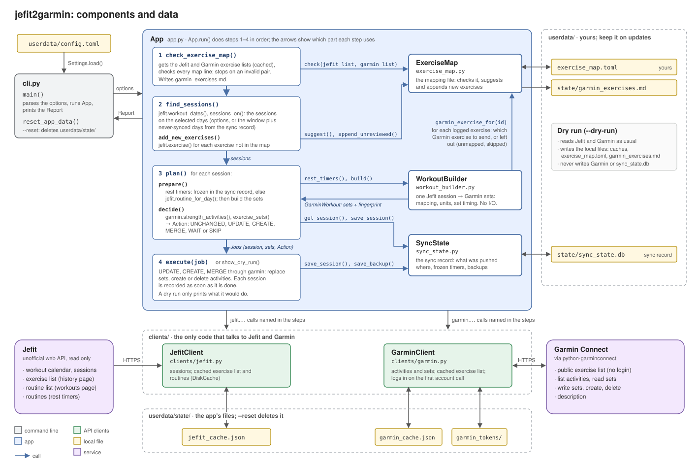
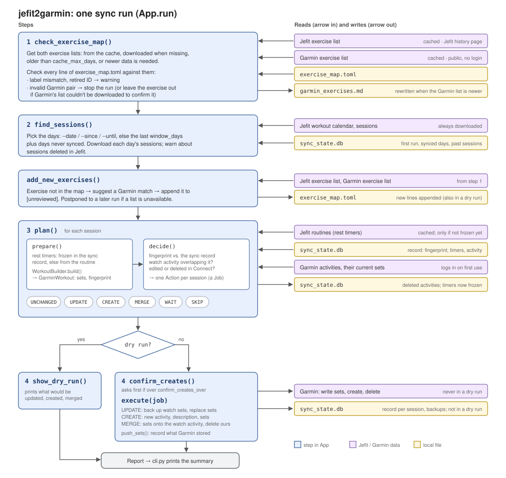

# jefit2garmin design

Copies strength workouts logged in Jefit (exercises, sets, reps, weights) into Garmin Connect,
either onto the strength activity the watch recorded or onto a new activity when there is none.

Status: the app is written and tested offline; not yet run against live accounts. A proof of
concept (since removed) showed both paths work: overwriting the sets on a watch activity
(2026-10-12) and creating a manual activity with sets (2015-06-19).

## Code layout

One main class per file, under `src/jefit2garmin/`. Start reading at `App.run()`. The two API
clients live in `clients/` and import nothing from the rest of the app, so they can be read,
tested or reused on their own.





The diagrams are hand-written SVG in `docs/`; edit them in a text editor or any SVG editor
(e.g. Inkscape) when the code changes.

| File | Main class | Contents |
|---|---|---|
| `cli.py` | — | the `jefit2garmin` command: parses options, creates `App`, calls `run()` |
| `app.py` | `App` | one sync run: find sessions, plan (`decide()` holds every rule), confirm, execute; `Action`, `Job`, `Report` |
| `settings.py` | `Settings`, `Options` | reads `config.toml`; the command-line options |
| `clients/jefit.py` | `JefitClient` | every Jefit call, typed results, page-data parser; cached exercise list and routines |
| `clients/garmin.py` | `GarminClient` | Garmin calls, `ExerciseSet` payload building; cached Garmin exercise list |
| `clients/disk_cache.py` | `DiskCache` | the clients' local copies: age, refresh and fallback rules (see Caches) |
| `exercise_map.py` | `ExerciseMap` | reading, checking and appending `exercise_map.toml`; suggesting Garmin matches |
| `workout_builder.py` | `WorkoutBuilder` | one Jefit session → `GarminWorkout` (exercise types, units, set timing) |
| `sync_state.py` | `SyncState` | `sync_state.db`: what was synced where, backups of watch sets |

| Other paths | Contents |
|---|---|
| `userdata/` | everything of the user's: `config.toml` (created by the first run from `settings.CONFIG_TEMPLATE`), `exercise_map.toml`, and the app's own files in `state/`. Kept out of git apart from its README. |
| `tests/` | read-only checks that the two clients still work against the real services: login and a download each (needs `userdata/config.toml`) |

Both clients pace requests, retry on rate limiting (429) with backoff, and raise one error type
(`JefitError`, `GarminError`) naming the call that failed.

## Data sources

### Jefit (unofficial web API, `https://www.jefit.com`)

| Call | Use |
|---|---|
| `POST /api/v2/auth/login` with `{"platform":"web","username":…,"passwordMd5":…}` | `accessToken`, `refreshToken`; later calls send `Cookie: jefitAccessToken=<token>` |
| `GET /api/v2/user` | user ID at `data.id` |
| `GET /api/v2/users/{id}/sessions/calendar?timezone_offset=-07:00` | every date with a workout (`has_logs`) |
| `GET /api/v2/users/{id}/sessions?startDate={unix local midnight}` | that day's sessions → `logs` (one per exercise) → `log_sets` |
| `GET /api/v2/user/exercises` | custom (`u_`) exercises |
| `GET /my-jefit/progress/history` with header `rsc: 1` | page data; `preLoadedExercises` holds built-in and custom exercises |
| `GET /my-jefit/workouts` with header `rsc: 1` | page data; every routine with its `days[].id` (day → routine lookup) and the user's default rest timer (`settings.timer`) |
| `GET /api/v2/routines/{routine_id}?expand=routine.days.day_exercises.interval,routine.user,routine.days.day_exercises.sets&sort=days.day_exercises.sort_order,days.day_exercises.index,days.day_exercises.local_id,days.day_exercises.sets.index` | routine days → exercises → sets, with per-set `rest_time` |

- Sets carry `date` = when the set was logged (its end). Old logs (seen in 2015) have `date: null`.
- `record_type` / `input_format`: `weight_and_reps`, `reps`, `duration`, `reps_and_duration`, `cardio`.
- A session's `day_id` is a routine day; each log's `day_exercise_id` is a routine `day_exercises[].id`,
  whose `sets[index].rest_time` is the rest timer after that set. The routine shows its current state,
  so old sessions may point at changed or deleted entries.
- Old sessions can reference retired exercise IDs that are no longer in the catalogue
  (`d_000000000183` "Cable Shoulder Extension", now `d_000000000250`).

### Garmin (`python-garminconnect` 0.3.17, pinned; Python 3.12+)

| Call | Use |
|---|---|
| `get_activities_by_date(start, end)` | find strength activities (`typeKey == "strength_training"`) |
| `get_activity_exercise_sets(id)` | read sets (backup before first overwrite) |
| `set_activity_exercise_sets(id, payload)` | replace all sets; atomic, one invalid pair rejects the whole write |
| `create_manual_activity(…, type_key="strength_training", …)` | new activity when the watch recorded none |
| `set_activity_description(id, text)` | note on created activities |

Payload per set: `exercises: [{category, name, probability: 100}]`, `setType` (`ACTIVE`/`REST`),
`repetitionCount`, `weight` (grams), `duration` (s), `startTime` (GMT, `YYYY-MM-DDTHH:MM:SS.0`),
`wktStepIndex`, `messageIndex`. `name: null` = generic for the category.

Garmin's exercise list: `https://connect.garmin.com/web-data/exercises/Exercises.json` and display
names in `…/web-translations/exercise_types/exercise_types.properties` (no login needed).

The list isn't exactly what the exercise-set API accepts, and there is no official definition of
what it does accept: testing against the real service is the source of truth. Known
differences are kept in `REJECTED_NAMES` in `clients/garmin.py` and left out of the list (so the
map check catches them before anything is sent). So far: in 16 categories the list has an entry
named after the category (`CALF_RAISE/CALF_RAISE` "Calf Raise") that the API refuses with
"400 Invalid Sub-Category"; it stands for the generic exercise, sent as `name: null`. Same-named
entries in other categories (`LEG_CURL/LEG_CURL`, `SQUAT/SQUAT`, …) are real and accepted. When
a write is refused, the run's failure report lists what was sent; add the culprit to the list.

## Files

Everything lives in the folder `config.toml` is in, `userdata/` by default (`--config` can point
elsewhere). The user's files are at the top; the app's own files are in `state/`, which `--reset`
deletes as a whole. Updating the code never touches `userdata/`.

| File (in `userdata/`) | Owner | Purpose |
|---|---|---|
| `config.toml` | user | credentials, time zone, optional settings |
| `exercise_map.toml` | user (app appends) | Jefit exercise ID → Garmin category + name; overrides the built-in map |
| `logs/jefit2garmin.log` | app | every run: console output plus debug detail (requests as method, path and status; decisions; exercises pushed; error traces). Rotated at 1 MB, 3 old files kept; never holds credentials or request bodies. Kept by `--reset`. |
| `state/sync_state.db` (SQLite) | app | what was synced where; see below |
| `state/garmin_exercises.md` | app | reference of every valid category/name, for editing the map |
| `state/jefit_cache.json` | app (`JefitClient`) | Jefit's exercise list, the routine list, each routine used |
| `state/garmin_cache.json` | app (`GarminClient`) | Garmin's valid category/name pairs, display names, muscles |
| `state/garmin_tokens/` | app (`GarminClient`) | Garmin login, so MFA isn't needed every run |
| `state/failed/<day>_<session>.json` | app | a push Garmin refused: the error, the exercises and the exact body sent; deleted when that session later succeeds |

A first `jefit2garmin --dry-run` creates all of them except `sync_state.db`.

### Built-in map and `exercise_map.toml`

`src/jefit2garmin/builtin_exercise_map.toml` ships with the code: mappings for Jefit's built-in
(`d_`) exercises, which are the same for every Jefit user, in a single `[base]` section with the
user file's line format (plus `format_version` and `map_version`). It is a layer under the
user's file:

- An exercise with a line in the user's file, in any section, uses that line; otherwise the
  built-in line, if any. The user's file only needs custom exercises and changes.
- Exercises the built-in map covers are not "new": no `[unreviewed]` line is written for them.
- `[base]` belongs to the built-in map only; in the user's file it is an error.
- A built-in pair Garmin's current list doesn't have never stops a run: it is reported and
  dropped for the run, and the exercise is treated as new (gets an `[unreviewed]` line). With
  only an old Garmin copy it is left out for the run instead.
- `tests/test_builtin_map.py` checks the file before a release, without an account: format,
  `d_` IDs only, the Jefit and Garmin link comments match each entry, and every pair is in
  Garmin's public list and not in `REJECTED_NAMES`.
- A changed built-in line changes the payload of workouts that use it, so they are re-pushed
  like after any map edit (window, or `--since`).

### `exercise_map.toml`

```toml
format_version = 1

[exercises]
d_000000000012 = { jefit = "Barbell Squat", category = "SQUAT", name = "BARBELL_BACK_SQUAT" }
d_000000000045 = { jefit = "Machine Fly",   category = "FLYE",  name = "" }

[skip]
d_000000000319 = "Step Machine"

[unreviewed]
d_000000000217 = { jefit = "Machine Hip Adduction", category = "", name = "" }
```

- `category = ""`: not mapped. The exercise is not sent to Garmin; each run prints a warning.
- `name = ""`: generic for the category.
- `[skip]` takes just the name, or a whole line moved from another section unchanged (its
  `category` and `name` are ignored), so moving a line never needs rewriting it.
- `[unreviewed]` must stay last; the app appends new exercises to the end of the file.
- The app only appends. It never edits, moves or removes the user's lines.
- Validation before any Garmin write. Errors (stop the run): syntax, invalid category/name,
  ID in two sections, `name` without `category`.
  Warnings: `jefit` label differs from the catalogue name; Jefit ID not in Jefit's exercise
  list (retired IDs are legitimate, so this can't be an error).
- New exercises get a filled-in line when a Garmin display name has the same words as the
  Jefit name in any order; otherwise empty, with up to three candidate pairs as comments.

### Caches

The clients keep local copies of what changes rarely: Jefit's exercise list, routine list and
routines, and Garmin's exercise list. The copies keep runs working when a service can't be
reached, or when Garmin stops publishing its list or Jefit changes its page data.

- A copy is downloaded again when it is older than `cache_max_days` (30), with
  `--refresh-caches`, or when the caller needs newer data:
  - an exercise ID not in the Jefit copy, used in a session newer than the copy (a new
    exercise); in an older session it is a retired ID and is appended to the map with an
    unknown label;
  - a routine copy older than the session it is needed for (the routine may have changed);
  - a routine day not in the routine list copy, in a session newer than the copy;
  - a pair `exercise_map.toml` has that the Garmin copy calls invalid (Garmin may have added it).
- At most one download per item per run.
- A failed download never stops a run. With a copy: the copy is used, with a warning. Without
  one: the run goes on without that data and leaves for a later run whatever needs it:
  - no Garmin list: the map isn't checked, and new exercises aren't added to the map;
  - a new exercise Jefit can't confirm: not added to the map this run;
  - a pair only the old Garmin copy calls invalid: that exercise is left out with a warning
    (a freshly downloaded list confirming it is invalid still stops the run);
  - no current routine: rest timers from an old copy, or estimates, used but not frozen.
  New exercises are only written to the map once both lists are available, because the app
  never changes a line afterwards. Exercises left out this way have their sets added later,
  when the workout is re-pushed.
- An empty download never replaces a good copy (it counts as a failed download).
- `garmin_exercises.md` is rewritten whenever the Garmin list is newer than the file.

### `sync_state.db`

One row per Jefit session:

| Field | Example |
|---|---|
| Jefit session ID, date | `12345678`, `2026-01-15` |
| Garmin activity ID | `20000000001` |
| created by the app | yes / no (watch activity) |
| fingerprint of the payload last pushed | hash |
| synced at | timestamp |
| exercises left out as unmapped | list of IDs |

- Reruns update the recorded activity instead of creating another (no duplicates).
- The app identifies its own activities by ID, so renaming them in Garmin breaks nothing.

## A sync run

1. Load and validate `exercise_map.toml`.
2. Log in to Jefit; get the exercise lists (cached, see Caches).
3. Get the workout calendar; select days (below).
4. For each day and session:
   1. Fetch the session; append unseen exercises to `[unreviewed]`.
   2. Build the payload (unmapped exercises left out with a warning).
   3. If the fingerprint matches `sync_state.db`, skip.
   4. Otherwise find the activity: the recorded one, else the strength activity overlapping
      the session most, else create one (see below). Back up existing sets before the first
      overwrite. Push; record the result.
5. Summary: synced, unchanged, created, still unmapped.

Garmin is only logged into if something needs pushing.

### Day selection

| Option | Days |
|---|---|
| none | last `window_days` (28) days, plus older days never synced (after the first run) |
| `--since DATE` | DATE to today |
| `--since A --until B` | A to B inclusive |
| `--until DATE` | all history to DATE |
| `--date DATE` | that day |
| `--dry-run` | show what would change; write nothing to Garmin or the sync record (see below) |
| `--refresh-caches` | download the exercise lists and routines again, whatever their age |
| `--overwrite-garmin-edits` | replace sets even where they were edited in Garmin Connect (see below) |
| `--reset` | delete all app data and stop; see below |

A dry run reads from both services but changes nothing in Garmin and doesn't touch
`sync_state.db`, which records only what has really been pushed. Local files are updated as in a
real run: the caches, `garmin_exercises.md`, and `exercise_map.toml` with new exercises. A first
`--dry-run` therefore fills the map for review before anything is synced.

`--reset` deletes `userdata/state/`: the sync record, `garmin_exercises.md`, the caches and the
Garmin tokens. The folder's location is fixed (next to `config.toml`), so deleting it as a whole
is safe. It keeps `config.toml` and `exercise_map.toml`, and touches nothing in Garmin or Jefit.
It lists what it will delete and asks first (`--yes` skips the question, `--dry-run` only lists). Losing the sync
record means the next run treats workouts as never synced: activities deleted in Connect can be
recreated, Connect edits are overwritten, and the backups are gone. App-created activities are
matched again by time overlap, so they aren't duplicated.

Dates are local and inclusive. Any date option replaces the default window.

### Activities with no watch recording

- Created with `create_manual_activity`: type `strength_training`, name `activity_name`
  ("Strength"), Jefit start time and duration, private.
- Description: "Created by jefit2garmin from Jefit session <id>".
- Safeguards: only create for sessions at least `create_after_hours` (24) old, since a late watch
  sync would otherwise duplicate it; confirm before a run creates more than
  `confirm_creates_over` (5); `--dry-run` shows the count.

### After a workout is synced

- Re-push only when the payload built from Jefit differs from the one last pushed (workout
  edited in Jefit, mapping filled in or changed). Otherwise skip.
- Before a re-push, compare the activity's current Garmin sets with the last pushed payload.
  If they differ (edited in Garmin Connect), skip and warn instead of overwriting.
- `--overwrite-garmin-edits` makes the selected days match Jefit regardless: sets edited in
  Connect are replaced, even when nothing changed on the Jefit side. Each synced session in
  the selection costs one Garmin read. Deleted activities are still not recreated.
- Activity deleted in Garmin Connect (one the app created or the watch's): record it and never
  recreate it or push to it again, whatever the options. Deleting it is taken as the user's
  decision.
- Workout deleted in Jefit: leave Garmin alone, report it. The app never deletes activities
  except in the merge below.
- Watch activity appears later for a workout the app created an activity for: merge. Push the
  sets onto the watch activity (which has the heart rate), and only once that succeeds delete
  the app-created activity and point the sync record at the watch activity.

### Set timing

- The watch records a free strength workout as one `UNKNOWN` set covering the whole session,
  so Jefit is the only source of set timing. Its sets replace the watch's entry.
- With Jefit timestamps: a set ends at its timestamp. Its duration is the gap since the previous
  set minus that set's routine `rest_time` (e.g. bench 190 s gap − 150 s timer = 40 s). First set
  of each exercise, gaps shorter than the timer, or no routine data: estimate (average of the
  exercise's other sets, else about 3 s per rep). Gaps become `REST` entries.
- Routine data is the routine's current state, not what it was when the workout was logged, so:
  - Use it only when the routine exercise matches the log (same `day_exercise_id` and same
    exercise ID); extra logged sets take the timer of the routine's last set.
  - Discard a derived duration outside a plausible range (e.g. under 10 s or over 3 min).
  - Store the timers used for each session in `sync_state.db` on first sync and reuse them on
    re-sync, so editing a routine later never changes or re-pushes already-synced workouts.
    Only timers from a routine copy taken at or after the session's start are frozen; ones
    from an older copy (a failed download) or estimates for lack of routine data are looked
    up again on later runs, and frozen once a current copy is available.
  - Only durations come from the routine. Exercises, reps and weights always come from the log.
- Without timestamps (old logs): sets spread evenly over the session.
- Garmin's "Work Time" is the sum of set durations, so it reflects the assumption.

### Exercise types

| Jefit `record_type` / `input_format` | Sent to Garmin |
|---|---|
| `weight_and_reps` | reps and weight as logged |
| `reps` (bodyweight) | reps; `weight: null` (Jefit logs no weight; the watch also stores `null`) |
| `duration` (plank, dead hang) | `duration` = logged seconds, `repetitionCount: null`, `weight: null`; the logged duration also replaces the timing estimate |
| `reps_and_duration` | reps and the logged duration |
| `cardio` | left out; cardio is recorded as separate Garmin activities |

Rule: send whatever Jefit recorded, convert weight using the session's `unit_system`
(imperial lb or metric kg → grams), and never invent a value Jefit doesn't have.

### Configuration

- `userdata/config.toml` (kept out of git): Jefit and Garmin credentials, time zone for created
  activities (e.g. `America/Los_Angeles`), `cache_max_days` (30).
- No config yet: the first run writes it from `settings.CONFIG_TEMPLATE` (commented, every
  optional setting shown) and stops, asking for the logins. A `config.toml` in the current
  folder instead is reported as misplaced; it holds passwords, so it is never moved
  automatically. Empty logins stop the run with a message naming the section.
- Garmin tokens in `userdata/state/`, inside the project, so MFA is not needed every run.
- Optional `[sync]` section; a missing key uses its default. Unknown keys, wrong types and
  negative numbers stop the run with an error.

| Key | Default | Meaning |
|---|---|---|
| `window_days` | 28 | days looked at on a run with no date options |
| `create_after_hours` | 24 | wait this long for the watch before creating an activity |
| `confirm_creates_over` | 5 | ask before one run creates more activities than this |
| `activity_name` | `"Strength"` | name of created activities |

## Open questions

- How Garmin Connect displays a `duration` set (untested).
- Field name for a timed set's duration in Jefit logs (assumed `duration`, as on cardio sets).
- Jefit token lifetime and refresh; whether `sessions?startDate=` returns more than one day.
- Whether one day can hold two Jefit sessions or two Garmin strength activities.
